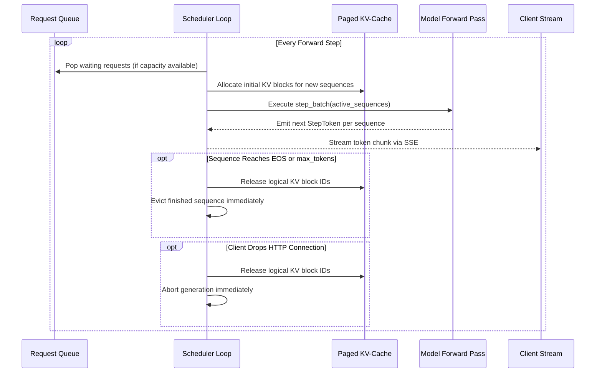

# Continuous Batching & Paged KV-Cache ⚡

Continuous batching (iteration-level scheduling) and paged memory allocation represent the core algorithmic engines powering high-throughput inference in Mini-Serve.

---

## 1. Iteration-Level Continuous Batching

Traditional inference servers utilize static batching, waiting for $N$ requests to arrive, padding them to the longest prompt, and keeping all sequences active until the slowest one completes. This creates:
1. **Head-of-Line Blocking**: Short 10-token queries sit idle waiting for 500-token queries to finish.
2. **GPU Underutilization**: Pad tokens waste GPU FLOPs without producing useful output.

### The Mini-Serve Continuous Batching Algorithm
Mini-Serve executes inference step-by-step at iteration granularity:



---

## 2. Paged KV-Cache Architecture

Standard KV caches pre-allocate contiguous virtual memory buffers for the maximum sequence length (e.g. 2,048 or 4,096 tokens). In production workloads, prompt and completion lengths vary widely, wasting 60%–80% of VRAM due to internal fragmentation.

### Block Allocation Strategy ([`src/cache/kv_cache.rs`](../src/cache/kv_cache.rs))
- **Block Size**: Logical accounting blocks (default: 16 tokens per block). Candle stores actual KV tensors in separate contiguous per-sequence buffers; these IDs do not address physical tensor pages.
- **Page Table**: Each sequence holds a logical list of physical block IDs (`Vec<usize>`).
- **Free Stack**: Free block IDs are managed in an $O(1)$ stack.
- **Dynamic Allocation**: As a sequence generates new tokens, new blocks are allocated on-demand only when a 16-token boundary is crossed:
  $$\text{Required Blocks} = \left\lceil \frac{\text{len}(\text{prompt}) + \text{len}(\text{output})}{\text{block\_size}} \right\rceil$$

### Memory Fragmentation Telemetry
Mini-Serve continuously tracks real-time cache fragmentation and exposes it via `/api/status` and `/metrics`:

$$\text{Utilization} = \frac{\text{Allocated Logical Blocks}}{\text{Total Logical Blocks}}$$

For nonzero free-block count, the fragmentation indicator is $(\text{contiguous free-ID runs} - 1) / \text{free blocks}$, clamped to `[0, 1]`; it is zero when no blocks are free. This measures the distribution of free logical IDs, not unused token slots or device-memory fragmentation.

---

## 3. Chained 16-Token Prefix Caching

When multiple requests share identical prompt prefixes (e.g., system instructions, few-shot examples, or retrieved context documents in RAG), repeating the prefill forward pass on those tokens is redundant.

### The Hashing & Lookup Algorithm ([`src/cache/prefix_cache.rs`](../src/cache/prefix_cache.rs))
1. Prompts are tokenized and partitioned into 16-token chunks:
   $$C_0 = [t_0, \dots, t_{15}], \quad C_1 = [t_{16}, \dots, t_{31}], \quad \dots$$
2. Each chunk is hashed using a chained cryptographic SHA-256 digest:
   $$H_0 = \text{SHA256}(C_0), \quad H_i = \text{SHA256}(H_{i-1} \,\|\, C_i)$$
3. If $H_i$ exists in the prefix cache:
   - A matching entry with KV activations can skip prefill for the cached prefix. An exact hit without logits replays the final prompt token from the preceding KV state.
   - The backend restores cached tensor snapshots into its per-sequence KV cache; it does not share physical pages through the logical block table.
4. **Eviction Policy**: Least-Recently-Used (LRU), with a default limit of 512 entries. Entries can retain snapshots of entire prefixes, so this limit does not imply an 8,192-token physical-memory bound. Tensor-budget enforcement is tracked in the roadmap below.

---

## 4. Client-Disconnect Cooperative Cancellation

In high-concurrency production deployments, clients frequently cancel requests (e.g., user navigates away, closes browser tab, or timeout fires). Continuing to compute tokens for abandoned requests wastes valuable GPU FLOPs and blocks other users.

### Implementation
Each sequence stream uses a bounded Tokio channel with 64 token slots and one reserved terminal slot. When the receiver closes, the scheduler removes the request and releases its backend state and logical blocks:
```rust
// Detected during the scheduler iteration loop:
if active[i].is_cancelled() {
    let cancelled = active.swap_remove(i);
    self.backend.cancel_sequence(&cancelled.request_id);
    self.cache.lock().release(&cancelled.request_id.0);
}
```
Cancellation is checked between forward steps. Its latency depends on the duration of the running step and scheduler availability; there is no verified fixed millisecond bound or interruption of an in-progress kernel.

---

## 5. Implementation Status & Active Roadmap

**2026-10-21 update:** P0 fixes and P1 serving features are implemented,
including authentication, per-client quotas, execution telemetry, dedicated
workers, and bounded shutdown. CPU process-signal tests and real Metal HTTP
Ctrl-C draining have passed. The SSE benchmark parser is repaired. Pinned
Qwen3-0.6B has focused independent generation references and pretrained Metal
numeric comparisons. The latest CPU suite passes **80 tests** with two opt-in
ignores; the separately invoked numeric Metal gate passes all **32 logit
comparisons**. See [client quotas](client_limits.md), [worker lifecycle](worker_lifecycle.md),
[GPU integration/reference evidence](gpu_validation.md), and
[numeric results and exact commands](pretrained_numerics.md).

Remaining work includes hosted CI on committed changes, broader model/quality
and load evaluation, current performance measurements, guide corrections,
physical tensor paging, and deployment expansion. CUDA work remains separate.
Checked items below describe their verified scope; adjacent open items retain
unfinished acceptance criteria. Earlier dated evidence is historical; no
validating commit or hosted CI result is recorded.

See the [production blocker investigation record](production_reproductions.md) for historical 2026-10-16 measurements and retained regression checks; the manual latency and contention probes have since been removed. Those checks reproduced HTTP-runtime blocking, generic chat formatting, and backend lock contention; the tested working tree passed the focused stop-handling and tensor-reservation checks. These results do not establish driver-level memory safety or multi-thread production-server latency.

| Capability | Control-Plane Layer ([`src/cache/`](../src/cache/)) | Tensor Execution Layer ([`src/backends/`](../src/backends/)) |
| :--- | :--- | :--- |
| **KV-Cache Block Management** | **Implemented**: Logical block IDs, admission accounting, and fragmentation telemetry via `/api/status`. These counters do not enforce actual tensor-memory usage; a separate [byte reservation budget](tensor_memory.md) covers active KV, prefix storage, and estimated execution memory. | **Roadmap**: Tensor memory currently resides in per-sequence buffers (`candle_nn::kv_cache::KvCache`) sized to each request’s token limit. Direct non-contiguous PagedAttention kernels remain future work. |
| **Prefix Caching** | **Implemented**: Chained SHA-256 chunk hashing, LRU eviction (512 entries), hit/miss counters, and telemetry. The entry limit is not a tensor-byte budget. | **Implemented; CPU and focused pretrained Metal coverage**: KV snapshots and optional logits can bypass prefill. Exact matches without saved logits replay the final token from the preceding KV state. Cached/uncached greedy output and numeric prefix-restoration comparisons pass on pretrained Metal; see [numeric scope](pretrained_numerics.md). |
| **Continuous Batching** | **Implemented**: Dynamic admission, bounded client channels with reserved terminal capacity, cancellation, and finished-sequence eviction. Full token channels terminate with an explicit error. | **Implemented; CPU and focused pretrained Metal coverage**: Batched decode projections and grouped-query attention. Request state survives interleaved workers; mixed-length batched logits match individual execution within documented tolerances. Published performance still needs current measurements. |

### 5.1 Review and Verification Baseline

This plan extends the existing roadmap across the serving stack. The following is the **original committed baseline**, reviewed on **2026-10-16** at `1803f13` (v0.2.0). Subsequent working-tree changes and validation are recorded below; this table is historical.

| Check | Result | Scope |
| :--- | :--- | :--- |
| Default test suite | Passed | Reports 19 passes; the Qwen3 model test returns early because local weights are absent. |
| Test suite with `metal` enabled | Passed | Same model-test limitation; enabling Metal does not establish GPU inference correctness. |
| Clippy, all targets, default and Metal configurations | Passed with warnings denied | Static linting; does not validate the behavior identified below. |
| `cargo fmt --check` | Failed | Formatting differences in `src/api/routes.rs`, `src/backends/candle.rs`, and `src/backends/qwen2.rs`. |
| Real-model generation and published benchmarks | Not verified | Requires model weights, suitable hardware, and a corrected benchmark harness. |

The original findings came from source inspection. Subsequent CPU regressions cover the completed fixes; open items still need their own acceptance evidence. Pretrained-model and device validation remain separate from CPU fixture coverage.

#### Current Maturity Assessment (2026-10-21, working tree)

These ratings describe demonstrated coverage and remaining limitations, not production-readiness guarantees. The latest CPU suite executes 80 tests, with two explicit ignores. Separately invoked pretrained Metal gates verify the focused behaviors recorded in [GPU verification](gpu_validation.md) and [numeric validation](pretrained_numerics.md); it is not broad production-readiness or output-quality validation.

| Area | Maturity | Assessment |
| :--- | :--- | :--- |
| **Control plane & continuous batching** | **Medium–High** | Admission, cancellation, worker-state isolation, and reserved terminal delivery have regression coverage. Quarantined-backend routing is implemented. Worker supervision and bounded draining have CPU and focused Metal checks. CPU process-signal/deadline tests and real Metal HTTP Ctrl-C draining pass; forced GPU hangs/deadline expiry remain unverified. Channel saturation terminates the slow request explicitly; it does not pause batch progress. |
| **API protocol & streaming** | **Medium** | JSON/SSE completion and explicit termination/error behavior are tested. Model identity and artifact-defined chat templates have CPU/reference and focused pretrained Metal coverage as of 2026-10-20. |
| **Inference & device kernels** | **Medium** | CPU fixtures cover grouped-query attention, batched decode, prefix restoration, and interleaved workers. Pretrained Metal cached/uncached greedy output and two-worker comparisons now pass the focused GPU gate. The shared backend mutex still serializes workers; dedicated inference threads now isolate synchronous forwards from the HTTP runtime. Four-prompt CPU/F32 versus Metal/F16 logit, restored-prefix, and mixed-length batched decode comparisons pass; broader model/device/load coverage remains open. |
| **Memory & KV cache management** | **Low for production memory control** | Logical block accounting coexists with real contiguous KV tensors and cached prefix activations. Physical paging is absent. Tensor-memory reservations, prefix eviction, cancellation release, and admission rejection are verified by CPU regressions and focused pretrained Metal inference. Device allocator measurements, forced OOM/recovery, and production load bounds remain open. |
| **Text generation & output quality** | **Low–Medium** | Prefix reuse and stop matching across tokens have CPU and focused pretrained Metal checks. Artifact-defined chat formatting has CPU/reference and focused pretrained Metal coverage. Four pinned Qwen3 cases match independent Transformers tokens/text for instruction following, roles, Spanish, and stops. Broader model/quality evaluation remains open. |
| **Production operations & security** | **Low** | CI and pre-commit checks exist; hosted CI execution is not yet recorded. API-key authentication, bounded per-client quotas, worker supervision, and bounded draining are implemented and tested. CPU process-signal/deadline tests and Metal HTTP draining pass. Execution/prefix counters and readiness have exact CPU checks and focused Metal evidence. Driver hangs and production load remain unverified. |

Returned Candle execution errors now quarantine the shared backend and trigger explicit request cleanup; see the [failure policy](device_failures.md). Reservation pressure is recoverable. This does not establish proactive GPU-memory protection or in-process device recovery after OOM.

### 5.2 Priority and Delivery Order

| Priority | Work | Completion gate |
| :--- | :--- | :--- |
| **P0: Correctness** | Isolate worker state, repair prefix restoration, and guarantee explicit response termination. | Regression tests cover interleaved workers, prefix reuse, and channel saturation without silent corruption or truncation. |
| **P1: Serving reliability** | Validate inputs, account for tensor memory, complete API behavior, and improve runtime lifecycle and telemetry. | Boundary inputs fail predictably, supported requests behave consistently, and resource/health reporting reflects execution. |
| **P1: Operations & security** | Add API-key authentication, per-client limits, and explicit device-failure handling before deployment expansion. | Protected routes reject unauthenticated traffic; quotas isolate clients; allocation/device failures follow a tested cleanup and readiness policy. |
| **P1: Verification** | Establish CI, repair benchmark parsing, and align documentation with measured behavior. | Checks pass automatically; model-test skips are visible; benchmark results are reproducible. |
| **P2: Scaling** | Implement tensor-backed paging and evaluate the existing Modal/CUDA and edge-control-plane roadmap. | P0/P1 gates pass before scaling claims or deployment expansion. |

Deliver each fix with its regression coverage. CI setup and benchmark-parser work can proceed alongside correctness fixes; performance comparisons depend on the corrected harness and inference behavior.

### 5.3 P0: Generation and Response Correctness

- [x] **Preserve each worker's active sequence state.** In [`CandleBackend::step_batch`](../src/backends/candle.rs), pruning against one worker's batch previously removed other workers' models. Keep immutable weights shared while making mutable sequence state worker-owned, or use request-scoped state whose lifetime is controlled explicitly. Avoid global pruning based on a single batch.

  **Acceptance:** Interleave two schedulers using the same weights and different prompts. Greedy outputs match isolated execution, KV lengths stay consistent with each sequence's position, and cancellation or completion in one worker does not remove another worker's state.

- [x] **Restore cached prefixes without appending a duplicate token.** When an exact cache match lacks saved logits, the previous backend restored all prompt KV entries and forwarded the last prompt token again. Restore only the state preceding that token before forwarding it, or recompute safely. Validate snapshot lengths and layer counts before use.

  **Acceptance:** Cached and uncached greedy generation agree for exact and partial hits, chunk-boundary lengths, and missing-logit cases. Include a longer prompt cached first, followed by its first 16 tokens as a complete prompt. Verify logits within an appropriate numeric tolerance and ensure snapshots remain unchanged after reuse.

- [x] **Make terminal delivery reliable without blocking the batch.** [`Scheduler`](../src/scheduler/scheduler.rs) previously used `try_send` for both tokens and terminal events, allowing a full channel to drop both. Give completion/error state a reliable bounded delivery mechanism. In [`API handlers`](../src/api/routes.rs), treat channel closure without terminal state as failure rather than constructing a successful completion with default usage.

  **Acceptance:** Use a controllable backend that emits more than 64 tokens without EOS. Saturate one receiver while another continues. The slow stream receives an explicit failure when consumption resumes; successful SSE responses include a finish reason and `[DONE]`; JSON responses never silently succeed with incomplete output. Cancellation and backend errors reclaim all sequence resources. Add timeouts so regressions fail instead of hanging.

#### P0 implementation evidence (2026-10-16, working tree)

- Worker state is request-scoped and removed on explicit completion/cancellation. CPU tests force two scheduler tasks to interleave over shared weights and compare greedy tokens with isolated execution. Separate step tests assert KV lengths after every iteration.
- Exact prefix hits without logits restore `matched_tokens - 1` KV entries before replaying the final prompt token. Snapshot layer count, shapes, and lengths are validated before mutation. Tests prime a 33-token prompt, then compare cached/uncached generation at lengths 15, 16, 17, 31, 32, and 33, including repeated hits with logits. Prompt logits agree within `1e-4`; cached snapshots remain unchanged after reuse.
- Each request has 64 token slots plus one reserved terminal slot. Full token channels report an error without waiting for the client. Tests exercise 100-token generation, a concurrently draining fast client, success at a full 64-token buffer, backend errors at saturation, cancellation, and allocation recovery. Both HTTP APIs reject unexpected channel closure; SSE success emits a finish reason and `[DONE]`.
- Validation: `cargo fmt --check`, `cargo clippy --locked --all-targets -- -D warnings`, `cargo test --locked`, and the corresponding Metal-feature checks. The default suite has 26 executed tests and one explicitly ignored pretrained-model test. These regressions use small randomly initialized CPU models and controllable backends, without downloaded weights. Metal-feature tests also run these fixtures on CPU. Pretrained cached/uncached and multiworker GPU comparisons, and CUDA, remain unverified; a subsequent single-request Metal smoke test is recorded below.
- P1 verification started: formatting is restored, and the Qwen3 model test is explicitly ignored unless requested. When requested with `--ignored`, missing weights fail. A concurrently added CI workflow covers CPU and macOS/Metal checks; hosted execution has not been verified. Benchmark repair and the remaining P1/P2 work below are still open. No validating commit has been created.

#### Pretrained inference smoke test (2026-10-16)

Ran `cargo test --locked --features metal --test test_qwen3 -- --ignored --nocapture` against downloaded `Qwen/Qwen3-0.6B` weights in `models/Qwen3-0.6B`. The backend reported an actual `Metal` device. Prompt: `The capital of France is`; greedy output: ` Paris. The capital of Italy is Rome. The capital of`. The request completed with `finish_reason=length`, 5 prompt tokens, 12 completion tokens, and 17 total tokens. The test verified explicit terminal delivery, usage consistency, zero remaining logical KV blocks, and clean scheduler shutdown. One test passed in 18.20 seconds including model initialization; this is a smoke test, not a throughput benchmark. Prefix reuse was not enabled for this request.

The sandboxed attempt panicked during Metal device initialization before inference; the successful run used host GPU access. This result does not validate sandbox GPU access, cached/uncached numerical equivalence on pretrained weights, multiworker GPU generation, or CUDA.

#### GPU verification of completed changes (2026-10-16)

Ran `cargo test --locked --features metal --test test_gpu_inference -- --ignored --nocapture`
with host GPU access on Apple M4 (8 GPU cores, 16 GB memory). The test asserted
an actual Metal device and passed in 23.86 seconds. It verified pretrained
cached/uncached output agreement for exact/partial hits and missing-logit replay,
JSON/SSE stop stripping and buffered-text flushing, natural EOS suppression,
two-worker output agreement, cancellation cleanup, tensor-budget rejection and
prefix eviction, and successful subsequent GPU inference. Peak charged memory
was 188,183,808 bytes within a 536,870,912-byte budget; active/prefix reservations
returned to zero after cleanup. Device OOM, numeric logit comparisons, CUDA,
and throughput remain unverified. See [GPU verification](gpu_validation.md) for
artifact hashes, exact outputs, sampling, scope, and the repeatable completion
gate now recorded in [AGENTS.md](../AGENTS.md).

### 5.4 P1: Reliable Serving and API Behavior

- [x] **Validate configuration and request limits before generation.** Reject zero block size, zero batch size, zero workers, and unusable cache capacity. Define the supported policy for `max_tokens: 0`; validate sampling ranges and device names. Check tokenized prompt length plus requested generation against model context and configured capacity, using checked arithmetic. Report cache exhaustion as a resource failure rather than normal completion at the requested length.

  **Acceptance:** Table-driven tests cover invalid settings, sampling boundaries, oversized prompts, combined prompt/output limits, and cache exhaustion. Invalid inputs return clear errors without panics, indefinite queuing, or an unexpected generated token. Every failure path releases allocated state.

  **Implementation evidence (2026-10-16, working tree):** Startup validates nonzero batch/queue/worker/cache settings, usable capacity, checked capacity multiplication, and device names/build features before loading weights. Explicit Metal requests fail on initialization errors; `auto` may select CPU. `max_tokens: 0` is rejected; temperature is finite in `[0, 2]`, top-p finite in `(0, 1]`, and stop strings nonempty. Submission tokenizes once, checks prompt-plus-output addition, model context (Candle's `max_position_embeddings`), and total logical capacity before enqueueing. Incremental logical allocation precedes forward execution; contention emits an error and reclaims backend state and blocks. Regression coverage in `tests/test_validation.rs` and `tests/test_api.rs` covers configuration/sampling boundaries, overflow, oversized and exact-limit requests, contention, cleanup, and JSON/SSE rejection. See [API limits](api_reference.md) for the contract. Validation passed: `cargo fmt --check`, `cargo clippy --locked --all-targets -- -D warnings`, `cargo test --locked`, and corresponding Metal-feature Clippy/test commands. Each suite executes 32 tests with one explicitly ignored pretrained-model test; the new checks use CPU fixtures, including in the Metal build. Tensor-byte budgeting remains the next open priority. No validating commit has been created.

- [x] **Introduce an actual tensor-memory budget.** The logical allocator does not own Candle's KV buffers, and prefix entries retain tensors outside its accounting. Track or conservatively reserve active KV allocations, prefix storage, and relevant execution headroom in bytes. Evict cached activations or reject admission before exceeding the configured budget. Account for underlying shared storage rather than counting tensor views as independent allocations.

  **Acceptance:** Expose logical-block accounting separately from tensor-memory estimates. Mixed prompt lengths, concurrent requests, prefix eviction, and cancellation stay within the documented budget and release retained resources. Document estimation limits until a physical page pool exists.


  **Implementation evidence (2026-10-16, working tree):** Shared byte reservations cover active KV, estimated request workspaces, fixed headroom, and owned prefix tensors. Active contiguous KV capacity is set to the checked prompt-plus-generation limit. Prefix insertion reserves before copying into compact, detached storage; cloned snapshot guards share one charge and keep evicted storage charged until the last guard drops. Admission evicts LRU snapshots or fails before forwarding. `/api/status` and `/metrics` report this separately from logical blocks. CPU fixtures inspect underlying storage sizes and cover concurrent reservations, mixed lengths, rejection, eviction, pinned snapshots, cancellation, and backend-error cleanup. See [tensor memory reservations](tensor_memory.md) for formulas, settings, library guard ownership, and excluded allocations. Weights and device allocator overhead remain outside exact accounting; this is a conservative reservation budget, not a physical allocator limit. Validation passed: `cargo fmt --check`, `cargo clippy --locked --all-targets -- -D warnings`, `cargo test --locked`, `cargo clippy --locked --features metal --all-targets -- -D warnings`, and `cargo test --locked --features metal`. Each test configuration executes 46 tests and explicitly ignores five pretrained/manual diagnostics. No validating commit has been created.

- [x] **Define allocation-failure and device-recovery behavior.** Preserve the existing propagation of returned backend errors, and add a documented policy for tensor allocation failure, device OOM, and an unusable device. Fail affected requests explicitly, reclaim reservations and request state, and remove unhealthy execution paths from routing. Verify device usability before accepting subsequent work; avoid automatic retries that could repeat the same failure or duplicate streamed output.

  **Acceptance:** Inject allocation and backend/device failures and assert explicit JSON/SSE errors, resource cleanup, and accurate readiness. Where supported, run a controlled memory-pressure check on real hardware. Document failures that cannot be recovered in-process; returned-error coverage must not imply protection from process aborts or host OOM termination.

  **Implementation evidence (2026-10-16, working tree):** Reservation pressure remains recoverable. Returned reservation/forward `BackendError`s quarantine execution; Candle shares health across workers, releases active/prefix tensor state, and rejects subsequent forwards. Schedulers terminate active/queued work explicitly, and routing filters quarantined workers. `/ready` returns 503 without an eligible worker; `/health` remains liveness. CPU regressions cover partial reservations, errors after streaming starts, shared active/queued cleanup, independent-backend routing, and admission rejection before tokenization. The pretrained Metal gate injects a returned error after real prefill/decode and checks SSE failure, shared quarantine, zero reservations, and 503 readiness/admission. Default/Metal suites execute 49 tests with five/six explicit ignores; formatting and both Clippy configurations pass. See [failure policy](device_failures.md) and [GPU evidence](gpu_validation.md) for exact commands/artifact identity. Recovery requires process restart; driver OOM/device loss, CUDA, panics, and host OOM remain unverified. No validating commit or hosted CI result is recorded.


- [x] **Implement stop handling across token boundaries.** Move shared stop matching into a layer used by both Mock and Candle backends. Buffer enough trailing text to withhold partial stop matches, remove matched stop text from output, suppress decoded EOS markers, and flush unmatched buffered text on normal termination.

  **Acceptance:** JSON and SSE tests cover single-token and multi-token stops, overlapping stop strings, UTF-8 text, EOS, and token limits. Mock and Candle follow the same output contract, with no stop marker leaking to the client.

  **Implementation evidence (2026-10-16, working tree):** A scheduler-owned incremental matcher filters output for Mock and Candle before either HTTP response mode sees it. It retains only suffixes that could complete a stop, strips the first completed match and all following text, handles overlapping and Unicode stops, and flushes unmatched suffixes on EOS or token limits. Candle suppresses `<|im_end|>` and `<|endoftext|>` text in prefill and decode; backend-local substring matching is removed. Raw decoded history remains separate from visible output so withheld text does not corrupt incremental decoding. Usage counts generated token IDs, including empty decodes and EOS; successful streaming telemetry now records authoritative terminal usage. HTTP tests cover both endpoints and modes; CPU Candle fixtures cover EOS suppression and the two stop reproductions now run as regression tests. The same default/Metal checks above passed with these regressions enabled. Pretrained Metal stop behavior is now verified by the focused GPU check above; broad output-quality and CUDA validation remain open.

- [x] **Use model-specific chat formatting and truthful model identity.** Replace generic `role: content` concatenation with the supported model's chat template. Validate roles and requested model names. List only available models, avoid duplicate `mock` entries, report the actual serving model, and update the dashboard's hardcoded model selection.

  **Acceptance:** Assert formatted prompt token IDs for supported Qwen chat templates. Unsupported model names fail clearly. Model listing, responses, dashboard requests, and explicitly enabled mock fallback agree about which backend is serving.

  **Verification update (2026-10-20):** Pinned Qwen template/token references,
  actual loaded identity, and JSON/SSE chat agree with direct greedy pretrained
  Metal inference. See [current GPU evidence](gpu_validation.md#verified-current-working-tree-2026-10-20).
  This does not establish broad pretrained generation quality or CUDA correctness.

- [x] **Separate inference execution from HTTP scheduling and supervise workers.** The historical implementation performed synchronous computation under a shared mutex inside an HTTP-runtime async task. Use a dedicated inference execution path with bounded communication and explicit cancellation. Retain worker handles, stop admission during shutdown, support bounded draining, and surface worker failures to routing and readiness checks.

  **Acceptance:** A delayed forward pass does not prevent health/status requests from being serviced within a defined test bound. Worker failure removes that worker from routing; a saturated worker does not cause rejection when another eligible worker has capacity. Shutdown completes within its configured deadline and leaves no active allocations or worker tasks.

  **Implementation evidence (2026-10-20):** The batching loop now runs on a dedicated thread/runtime. Supervisor handles join workers; forward panics fail active/queued streams and remove routing eligibility. Admission retries available workers after queue saturation. Ctrl-C stops admission, drains until the configured deadline, then enforces a process exit bound. Four CPU regressions cover blocking-forward HTTP responsiveness, panic cleanup, queue routing, and draining. Default/Metal suites and Clippy pass; the explicit pretrained Metal gate fails its missing-weights prerequisite. Focused GPU lifecycle verification subsequently passed. CPU process-signal/deadline regressions and real Metal HTTP Ctrl-C draining also passed; forced GPU hangs/deadline expiry remain unverified. See [commands, results, and limitations](worker_lifecycle.md).

- [x] **Authenticate protected API routes.** Add configurable API-key verification for inference and other explicitly protected routes, and document any public liveness endpoint. Keep credentials out of request logs, error payloads, and the dashboard. Define how local development and authenticated deployments are configured.

  **Acceptance:** Missing or invalid credentials are rejected before tokenization, queue admission, or tensor reservation. Valid credentials work for JSON and SSE. Tests cover protected routes and explicitly public endpoints, and logs do not expose credentials.

  **Implementation evidence (2026-10-20):** `RLSE_API_KEY` / `--api-key`
  enables bearer authentication before request parsing/tokenization/admission.
  Inference, model listing, status, and metrics require credentials; health and
  readiness remain public. The authenticated dashboard displays a static notice
  without handling secrets. CPU tests cover invalid/missing/duplicate headers,
  protected/public routes, pre-admission rejection, redacted errors/settings,
  and successful JSON/SSE. The explicit Qwen3-0.6B Metal gate verifies both
  authenticated generation routes/modes against direct greedy output and
  checks cleanup. Default/Metal suites each pass 62 tests; formatting and both
  Clippy configurations pass. See [configuration and limitations](api_authentication.md)
  and [GPU artifacts/commands/results](gpu_validation.md#verified-current-working-tree-2026-10-20).
  Per-client identity and quotas are implemented below; distinct configured keys identify independent clients.

- [x] **Add per-client request and concurrency limits.** Keep existing queue/capacity rejection as global overload protection. Add bounded request-rate and concurrent-generation quotas per authenticated client, with a documented identity policy when authentication is disabled. Release concurrency permits on completion, error, cancellation, and shutdown.

  **Acceptance:** A client exceeding its quota receives HTTP 429 with appropriate retry information while another eligible client can continue. Concurrent requests cannot bypass quotas. Disconnects and failed requests do not leak permits, and client-limit bookkeeping has a bounded lifetime and size.

  **Current evidence:** [Client quota policy and regressions](client_limits.md)
  cover bounded client records, atomic acquisition, HTTP 429/Retry-After,
  independent clients, and permit cleanup. The [pretrained Metal gate](gpu_validation.md#pinned-weights-and-pretrained-metal-recheck-2026-10-21)
  passed quota isolation, rejection/recovery, and disconnect cleanup.

- [x] **Make telemetry describe actual work.** Count prefix hits and saved tokens once, when reuse occurs, rather than at both scheduler lookup and backend lookup. Report real worker readiness. Measure generated tokens consistently for streaming and JSON responses, and expose queue delay, time to first token, errors, cancellations, and memory accounting.

  **Acceptance:** Deterministic scenarios produce exact expected counters. Metadata-only prefix matches do not claim skipped prefill work. Equivalent JSON/SSE requests agree on usage, and failed workers cannot appear healthy.

  **Current evidence:** `tests/test_execution_telemetry.rs` asserts exact
  JSON/SSE generated-token and outcome counters, queue-delay/TTFT counts, and
  unhealthy-worker reporting. CPU prefix regressions count only actual reuse;
  metadata-only lookup does not claim saved prefill. The [Metal integration
  record](gpu_validation.md#pre-commit-verification-2026-10-20) verifies prefix
  counters and terminal usage after real inference and warm/cold HTTP runs.

### 5.5 P1: Tests, Benchmarks, and Documentation

- [ ] **Verify the formatting baseline and CI on a clean checkout.** Formatting, the [CPU/macOS CI workflow](../.github/workflows/ci.yml), and the [pre-commit hook](../.githooks/pre-commit) have been added in the working tree. Keep this item open until hosted jobs pass on the committed changes. Run the checks below with a committed lockfile. Keep expensive real-model checks separate and make their prerequisites and skipped status visible.

  ```bash
  cargo fmt --check
  cargo clippy --locked --all-targets -- -D warnings
  cargo test --locked
  # On a supported macOS runner:
  cargo clippy --locked --features metal --all-targets -- -D warnings
  cargo test --locked --features metal
  ```

  **Acceptance:** A clean checkout passes the required jobs. Preserve the added tests that actually fill all 64 token slots and admit work while another request is decoding. Real-model jobs must fail when required weights are missing rather than report a skipped body as a pass. Record actual device selection; compiling with Metal enabled alone is not a GPU correctness check.

- [x] **Establish focused Qwen3 pretrained generation and numeric regressions.** Add a small reproducible prompt set for pinned Qwen3-0.6B covering instruction following, role handling, stop behavior, and multilingual output. Compare against the same model revision and sampling settings in a reference implementation. Extend the existing Metal smoke evidence with cached/uncached and multiworker comparisons on actual hardware.

  **Acceptance:** Record model/tokenizer revisions, chat template, sampling parameters, device, expected behaviors, and reference results. Use deterministic token/logit comparisons where appropriate and explain numerical tolerances. A single factual completion or passing mock tests must not be reported as broad output-quality validation.

  **Numeric regression addition (2026-10-21):** The existing four-case independent
  generation fixture now also drives pretrained Metal/F16 versus Candle CPU/F32
  full-vocabulary logit comparisons, restored-prefix checks, and mixed-length
  batched decode comparisons. See [numeric validation](pretrained_numerics.md)
  for commands, tolerances, artifact identity, results, and limits. Broader
  model/quality coverage remains open; the numeric CPU reference uses the same
  model implementation.

- [ ] **Broaden pretrained model and quality coverage.** Extend the focused
  Qwen3 reference set to Qwen2.5 and more prompts, languages, longer contexts,
  and sampling settings. Record independent references and device-specific
  tolerances. The completed four-case regression does not close this work.

- [x] **Repair and exercise the benchmark harness.** In [`examples/bench.rs`](../examples/bench.rs), buffer incomplete SSE frames and UTF-8 across network chunks. Require successful HTTP status, recognize stream errors, and require terminal completion. Exclude the empty finish chunk from token counts; use authoritative usage where available. Separate generation throughput from end-to-end latency and label the measurement method.

  **Acceptance:** Parser tests split valid SSE at arbitrary byte boundaries and handle errors and premature EOF. Counts agree with server usage, including tokens that decode to empty text. Exercise repeated warm/cold runs with warmup and explicit model/device/sampling identity.

  **Current evidence:** `src/sse.rs` tests arbitrary byte splits, UTF-8,
  errors, premature EOF, terminal chunks, and authoritative usage. The
  [real Metal HTTP record](gpu_validation.md#pre-commit-verification-2026-10-20)
  passed three rounds each of warm/cold benchmarks, one warmup per mode,
  concurrency two, and 12-token limits. These correctness runs do not
  revalidate historical throughput claims.

- [ ] **Publish current performance measurements and qualify historical claims.**
  Use the repaired harness to publish repeated measurements with model revision,
  hardware, build flags, warmup, concurrency, and separate cold/warm prefix runs.
  Distinguish client-observed decode rate from end-to-end latency. Revalidate
  historical comparisons before treating them as the current baseline.

- [ ] **Align existing guides with the implementation.** Update the root README's test count and explain model-test prerequisites. Correct claims about physical paging, deterministic memory bounds, direct prefix-block sharing, worker health filtering, fragmentation measurement, and cancellation latency. Distinguish implemented behavior from intended behavior and historical measurements.

  **Acceptance:** Cross-check the [architecture](architecture.md), [API reference](api_reference.md), [backend guide](backends_and_models.md), and [benchmark guide](benchmarks_and_performance.md) against code and reproducible checks. Link roadmap statements to this plan rather than maintaining competing completion lists.

  **Still open:** The root README reflects the current prerequisites and
  limits, but the architecture guide still calls logical cache blocks physical,
  and the benchmark guide retains outdated methodology and unqualified
  historical claims. Those guide corrections are not yet complete.

### 5.6 P2: Physical Paging and Deployment Expansion

- [ ] **Connect allocation to tensor execution.** Implement a tensor-backed page pool and attention operations that consume per-sequence block tables. Define reference counting and safe reuse for shared prefix pages. Preserve the existing contiguous implementation as a correctness reference during development.

  **Acceptance:** Paged and reference paths agree numerically; measured allocation grows with admitted token pages rather than maximum context per sequence. Validate page sharing, eviction, cancellation, fragmentation, and supported device behavior before claiming PagedAttention support.

- [ ] **Resume the existing scaling roadmap after reliability gates pass.** Evaluate the [Modal and `cudarc` roadmap](backends_and_models.md#4-future-backend-roadmap-serverless-modal--cudarc) and the root README's Cloudflare Workers integration. Base the next deployment target on validated memory and concurrency measurements.

  **Acceptance:** Each deployment target has a reproducible build/run procedure, readiness checks, bounded shutdown, and load measurements using the corrected benchmark harness. Record unsupported hardware or model combinations explicitly.

### 5.7 Completion Evidence

Close each checkbox only when the change, regression coverage, and relevant documentation land together. Record the validating commit, commands, model/hardware prerequisites, and results in the change description. Keep unresolved or untested device paths open; a passing mock suite alone does not establish real-model correctness or production readiness.

**Roadmap reconciliation (2026-10-21):** Updated the current summary, capability
table, maturity assessment, and completion checkboxes against source, regression
tests, and the linked inference records. Split focused Qwen3 verification and
benchmark repairs from broader evaluation and performance publication. This is
a documentation-only follow-up to the CPU and actual Metal runs recorded in
[numeric verification](pretrained_numerics.md); it introduces no execution
changes or new inference claims. Local Markdown link targets were checked for
this guide and the root README, and `git diff --check` passed. Historical dated
records retain their original results. Hosted CI and a validating commit remain
unrecorded.


